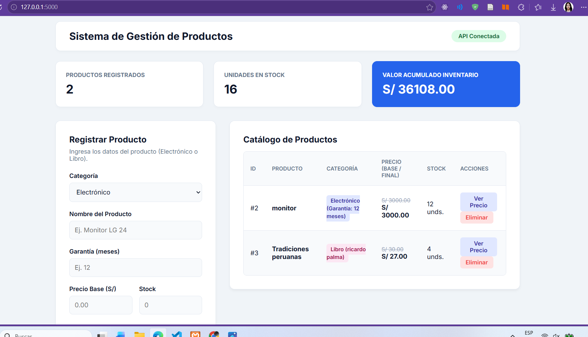
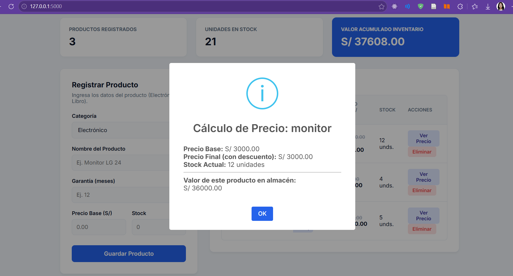
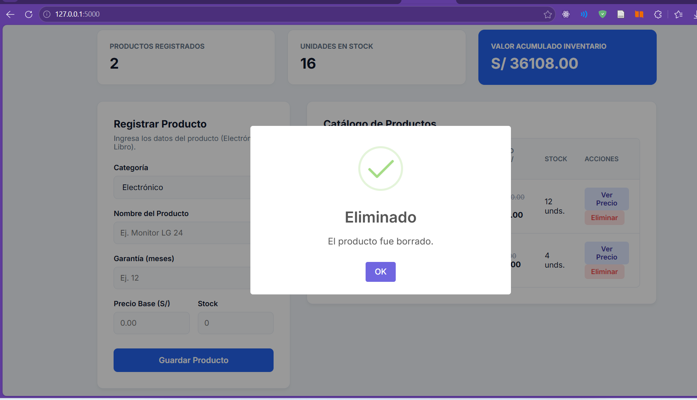
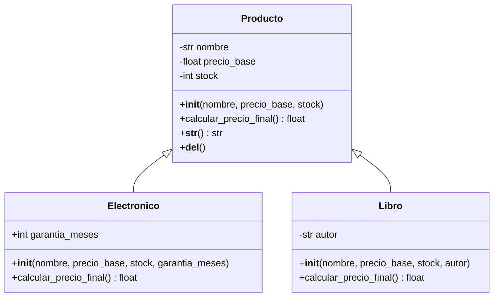
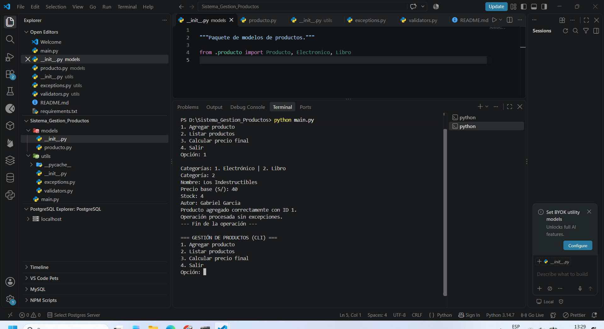
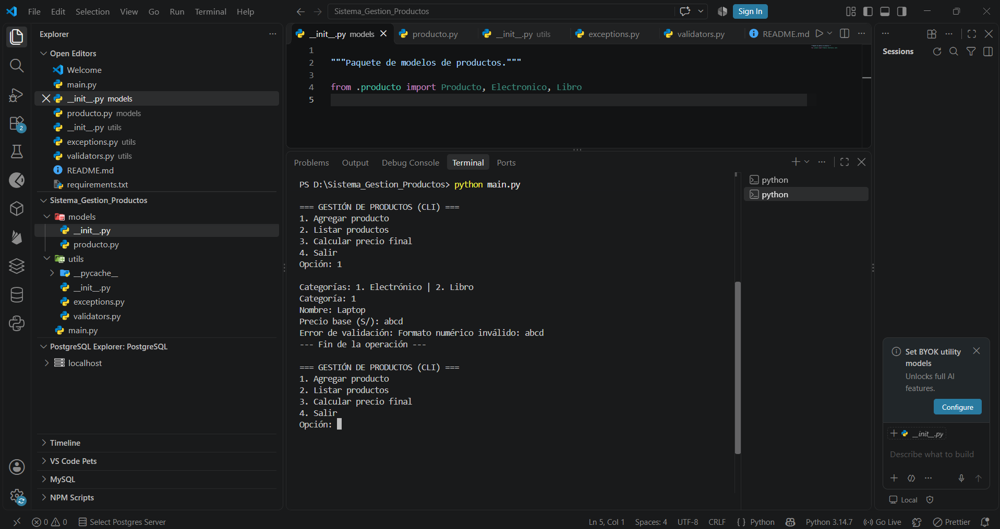
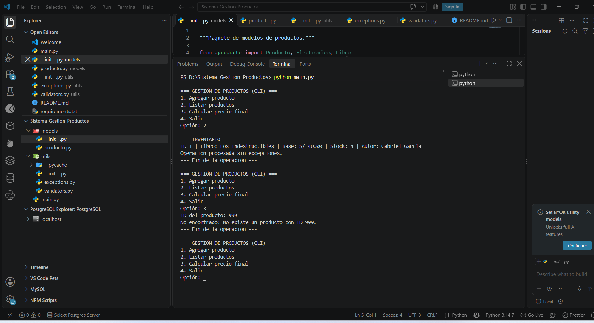

# Sistema de Gestión de Productos CLI

**Asignatura:** Desarrollo de Aplicaciones Web (IS093A)  
**Estudiante:** Brittany Gonzales Quiñonez  
**Práctica:** Semana 10 — Desarrollo Web Fullstack 

## FRONTEND

Como se observa en frontend




## Cómo ejecutar

Abrir la carpeta raíz del proyecto y ejecutar:

```bash
python api.py
```

En algunos Windows puede utilizarse `py main.py`.

## Estructura

```text
Sistema_Gestion_Productos/
├── main.py
├── models/
│   ├── __init__.py
│   └── producto.py
├── utils/
│   ├── __init__.py
│   ├── exceptions.py
│   └── validators.py
├── README.md
└── requirements.txt
```
## 1. Diagrama de clases (herencia, atributos y métodos)
La clase base `Producto` define las características generales, como nombre, precio base y stock. A partir de ella se derivan las clases `Electronico` y `Libro`, que incorporan atributos específicos y sobrescriben el método `calcular_precio_final()` según sus propias reglas de cálculo.

### 1.1. Diagrama UML de clases



### 1.2. Descripción de las clases

- **Producto:** clase base que administra los atributos comunes mediante encapsulamiento y validaciones. Define el método `calcular_precio_final()`, que debe ser implementado por las clases derivadas.
- **Electronico:** clase derivada que incorpora el atributo `garantia_meses`. Calcula el precio final aplicando un descuento del 5 % cuando el stock supera las 50 unidades.
- **Libro:** clase derivada que incorpora el atributo `autor`. Calcula el precio final aplicando un descuento del 10 % sobre el precio base.

### 1.3. Principios de POO aplicados

- **Herencia:** las clases `Electronico` y `Libro` reutilizan los atributos y comportamientos de `Producto`.
- **Encapsulamiento:** se controla el acceso a los atributos mediante propiedades (`@property`) y validaciones.
- **Polimorfismo:** cada clase derivada implementa su propia versión de `calcular_precio_final()`.
- **Abstracción:** la clase `Producto` concentra las características comunes de los productos.

## 2. Explicación del MRO y justificación de herencia frente a composición

### 2.1. Método de Resolución de Orden (MRO)

El *Method Resolution Order* (MRO) es el mecanismo utilizado por Python para determinar el orden en que se buscan los métodos y atributos dentro de una jerarquía de clases.

En el sistema desarrollado se utiliza herencia simple, por lo que el orden de resolución es:

**Para la clase Electronico:**

```python
Electronico → Producto → object
```

**Para la clase Libro:**

```python
Libro → Producto → object
```

Este orden permite que las clases derivadas accedan a los métodos y atributos de la clase base mediante `super()`, evitando la duplicación de código.

El MRO puede verificarse utilizando el método `mro()`:

```python
print(Electronico.mro())
print(Libro.mro())
```

### 2.2. Aplicación de super()

El método `super()` se utiliza en los constructores de las clases derivadas para ejecutar la inicialización definida en la clase `Producto`.

De esta manera, los atributos comunes se inicializan mediante un único constructor, mientras que cada clase derivada incorpora sus características particulares.

Su utilización facilita el mantenimiento del código y permite ampliar la jerarquía de clases sin repetir instrucciones.

### 2.3. Justificación de la herencia frente a la composición

Se seleccionó la **herencia** porque existe una relación directa de tipo *«es un»* entre las clases:

- Un electrónico es un producto.
- Un libro es un producto.

Ambos tipos comparten atributos y comportamientos generales, pero presentan características y reglas de cálculo específicas.

La **composición**, en cambio, resulta más adecuada cuando una clase contiene o utiliza objetos de otra clase, estableciendo una relación de tipo *«tiene un»*.

En este sistema, la herencia permite reutilizar código, centralizar las validaciones comunes y aplicar polimorfismo para calcular los precios finales.

### 2.4. Conclusión técnica

La implementación de herencia simple y el uso de `super()` permiten mantener una estructura modular, reutilizable y extensible. Asimismo, el MRO garantiza un orden definido para la resolución de métodos, mientras que el polimorfismo permite que cada tipo de producto tenga un comportamiento específico sin modificar la lógica general del sistema.

## Pruebas y capturas requeridas

## 3. Evidencias de ejecución

A continuación, se presentan las capturas de pantalla que evidencian el funcionamiento del Sistema de Gestión de Productos (CLI), incluyendo un caso exitoso y dos excepciones controladas.

### 3.1. Caso exitoso: Registro y cálculo del precio final

Se evidencia el registro correcto de un producto electrónico y el cálculo de su precio final, aplicando las reglas correspondientes según el tipo de producto.



### 3.2. Excepción ValidationError: Validación de datos incorrectos

Se demuestra el manejo de la excepción `ValidationError` al ingresar un valor no numérico en el precio del producto. El sistema identifica el error y muestra un mensaje de validación sin finalizar inesperadamente.



### 3.3. Excepción NotFoundError: Producto inexistente

Se evidencia el manejo de la excepción `NotFoundError` al solicitar el precio final de un producto cuyo identificador no existe en el inventario. El sistema muestra un mensaje informativo y permite continuar con su ejecución.


